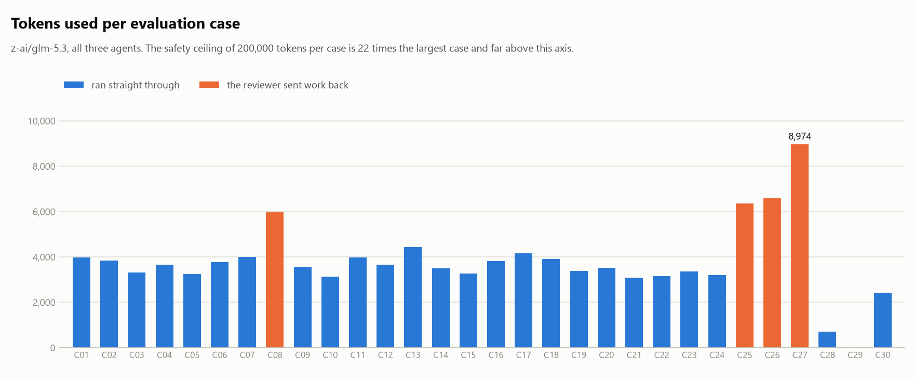
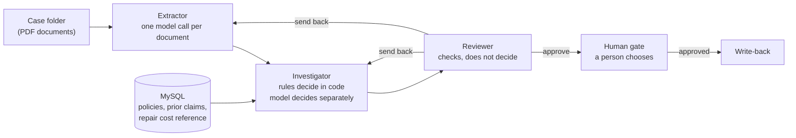

# Casefile

سیستم چندعاملی برای بررسی اولیه‌ی پرونده‌های خسارت بیمه‌ی خودرو، با گیت تأیید انسانی.

[English version](README.md)

هر پرونده‌ی خسارت به شکل یک پوشه مدرک می‌رسد: فرم اعلام خسارت، برآورد تعمیرگاه و گاهی گزارش پلیس. سه عامل مدارک را می‌خوانند، آن‌ها را با بیمه‌نامه و سوابق خسارت مقایسه می‌کنند و یک توصیه می‌نویسند. بعد یک انسان آن را تأیید یا رد می‌کند. **بدون این تأیید هیچ پرداخت یا ثبتی انجام نمی‌شود** و این را خود پایگاه داده تضمین می‌کند، نه فقط کد برنامه.

این یک پروژه‌ی تمرینی است. مدارکش مصنوعی و قواعد تصمیمش ساده‌شده‌اند. هدفش نشان‌دادن انضباط مهندسی در کار با مدل زبانی است: نتایجی که با انتظارهای ازپیش‌ثبت‌شده سنجیده شده‌اند، اجراهایی که همیشه متوقف می‌شوند، و محدودیت‌هایی که صریح گفته شده‌اند.

## نتایج

۳۰ پرونده‌ی ارزیابی یک بار، از PDF تا گیت انسانی، با هر سه عامل و مدل `z-ai/glm-5.3` اجرا شدند.

| معیار | نتیجه |
|---|---|
| تعداد پرونده‌ها | ۳۰ |
| خودشان متوقف شدند | ۳۰ از ۳۰ |
| به نتیجه‌ی ازپیش‌ثبت‌شده رسیدند | ۳۰ از ۳۰ |
| مدل به همان نتیجه‌ی قواعد رسید | ۲۶ از ۲۶ پرونده‌ی کامل‌شده |
| مدل در نتیجه، دلیل و مبلغ با قواعد یکی بود | ۲۶ از ۲۶ پرونده‌ی کامل‌شده |
| پرونده‌هایی که Reviewer کار را برگرداند | ۴ |
| ثبت نهایی بدون تأیید انسان | ۰ |
| تعداد فراخوانی مدل | ۱۶۴ |
| توکن، همه‌ی پرونده‌ها | ۱۱۳٬۸۴۴ |
| توکن، پرمصرف‌ترین پرونده | ۸٬۹۷۴ |
| سقف توکن هر پرونده | ۲۰۰٬۰۰۰ |

<picture>
  <source media="(prefers-color-scheme: dark)" srcset="docs/tokens_per_case_dark.png">
  
</picture>

این عددها چه می‌گویند:

- **هر اجرا متوقف شد، و همان‌جا که انتظار می‌رفت.** ۲۶ پرونده‌ای که باید به توصیه می‌رسیدند، رسیدند. چهار پرونده‌ای که خطایی جبران‌ناپذیر در آن‌ها تزریق می‌شود با `escalated` تمام شدند، هر کدام با همان ترمزی که خطا برایش طراحی شده بود: سقف بازبینی، خروجی نامعتبر، بودجه و سقف گام.
- **مدل در هر ۲۶ پرونده‌ی کامل‌شده با قواعد هم‌نظر بود**، در نتیجه، دلیل و مبلغ. هیچ‌کدام از این پرونده‌ها برای نوشتن یا تنظیم پرامپت استفاده نشده بود.
- **Reviewer یک خطا گرفت که کسی آن را نکاشته بود.** سه مورد از چهار برگشت، خطاهای تزریق‌شده‌اند (C25، C26، C27). چهارمی، C08، یک خسارت عادی است. تصمیم درست بود، ولی توضیح مدل می‌گفت مبلغ قابل‌پرداخت ۳٬۵۰۰ از کم‌کردن فرانشیز ۱٬۰۰۰ از خسارت خودرو (۳٬۶۰۰) به دست آمده است. این مبلغ از کل خسارت (۴٬۵۰۰) می‌آید. Reviewer همان جمله را نقل کرد و کار را برگرداند؛ توضیح بازنویسی‌شده تأیید شد.
- **هیچ چیزی ثبت نهایی نشد.** بعد از اجرا ۲۶ توصیه پشت گیت منتظر مانده‌اند، بدون هیچ تأیید و هیچ ثبت نهایی.
- **هزینه.** یک پرونده‌ی معمولی سه گام، پنج یا شش فراخوانی مدل و ۳٬۰۰۰ تا ۴٬۵۰۰ توکن برد. میانه‌ی زمان هر فراخوانی ۳٫۸ ثانیه، صدک ۹۰ آن ۱۹ ثانیه و بدترین حالت ۴۸ ثانیه بود؛ ۱۶۴ فراخوانی حدود ۲۰ دقیقه زمان مدل گرفت.

دو اندازه‌گیری محدودتر پشت این نتیجه است:

| اندازه‌گیری | نتیجه |
|---|---|
| خواندن مدارک: فیلدهایی که Extractor دقیقاً مطابق متن مدرک گزارش کرد | ۳۴۴ از ۳۴۴، در ۶۷ فراخوانی مدل |
| تصمیم‌گیری، روی مجموعه‌ی آزمایشی جدا با ۳۰ خسارت: هم‌نظری با قواعد در سه سطح استدلال کم، زیاد و حداکثر | ۲۸، ۲۹ و ۳۰ از ۳۰ |
| اسکلت کنترل با عامل‌های ساختگی (بدون مدل): پرونده‌هایی که مطابق پیش‌ثبت تمام شدند | ۳۰ از ۳۰ |

در مجموعه‌ی آزمایشی همه‌ی اختلاف‌ها یک نوع خطا بود: غلط شمردن سوابقی که داخل بازه‌ی ۳۶ ماهه می‌افتند. مدل با استدلال کم، بدون حساب‌کردن جواب می‌داد. ارزیابی برای تصمیم از استدلال حداکثر استفاده می‌کند و این تنظیم پیش از اجرای ارزیابی، روی مجموعه‌ی آزمایشی ثابت شد. عدد ۳۰ از ۳۰ با عامل‌های ساختگی فقط می‌گوید مسیریابی، ترمزها و مدارک با هم جورند؛ نتیجه‌ی خود سیستم نیست.

**نکته‌ای درباره‌ی خود اجرا.** اجرای زنده به‌اشتباه هم‌زمان در دو فرایند شروع شد. برای همین بعضی درخواست‌ها دو بار به مدل فرستاده شد و ضبط‌ها برای آن‌ها یک پاسخ را نگه داشته‌اند. گزارش، بازپخش همان پاسخ‌های نگه‌داشته‌شده است و تست‌ها هم همین را بررسی می‌کنند. خلاصه‌ای که اجرا هنگام زنده‌بودن چاپ کرد و گزارش بازپخش‌شده در نتیجه‌ی همه‌ی پرونده‌ها یکی‌اند. جایی که دو پاسخ به یک درخواست یکسان فرق داشت، تفاوت در جمله‌بندی سه توضیح و در شمار توکن‌ها بود (۱۱۳٬۷۲۱ در خلاصه‌ی زنده در برابر ۱۱۳٬۸۴۴ در بازپخش)؛ این نشانه‌ی مستقیمی است که temperature صفر و seed ثابت این سرویس را قطعی نمی‌کنند.

<details>
<summary>نتیجه‌ی هر پرونده</summary>

| Case | Kind | Pre-registered | Observed | Match | Model vs rules | Steps | Tokens |
|---|---|---|---|---|---|---:|---:|
| C01 | clean | recommend_pay / covered / 75920 | recommend_pay / covered / 75920 | yes | same | 3 | 3,967 |
| C02 | clean | recommend_pay / covered / 53140 | recommend_pay / covered / 53140 | yes | same | 3 | 3,832 |
| C03 | clean | recommend_pay / covered / 67540 | recommend_pay / covered / 67540 | yes | same | 3 | 3,302 |
| C04 | clean | recommend_pay / covered / 53890 | recommend_pay / covered / 53890 | yes | same | 3 | 3,660 |
| C05 | clean | recommend_pay / covered / 5080 | recommend_pay / covered / 5080 | yes | same | 3 | 3,252 |
| C06 | clean | recommend_pay / covered / 4060 | recommend_pay / covered / 4060 | yes | same | 3 | 3,770 |
| C07 | clean | recommend_pay / covered / 4670 | recommend_pay / covered / 4670 | yes | same | 3 | 4,001 |
| C08 | clean | recommend_pay / covered / 3500 | recommend_pay / covered / 3500 | yes | same | 5 | 5,962 |
| C09 | natural | refer_to_adjuster / amount_above_reference | refer_to_adjuster / amount_above_reference | yes | same | 3 | 3,566 |
| C10 | natural | refer_to_adjuster / amount_above_reference | refer_to_adjuster / amount_above_reference | yes | same | 3 | 3,131 |
| C11 | natural | refer_to_adjuster / frequent_prior_claims | refer_to_adjuster / frequent_prior_claims | yes | same | 3 | 3,969 |
| C12 | natural | refer_to_adjuster / frequent_prior_claims | refer_to_adjuster / frequent_prior_claims | yes | same | 3 | 3,650 |
| C13 | natural | refer_to_adjuster / frequent_prior_claims | refer_to_adjuster / frequent_prior_claims | yes | same | 3 | 4,426 |
| C14 | natural | recommend_deny / below_deductible | recommend_deny / below_deductible | yes | same | 3 | 3,499 |
| C15 | amount_mismatch | refer_to_adjuster / document_mismatch | refer_to_adjuster / document_mismatch | yes | same | 3 | 3,275 |
| C16 | amount_mismatch | refer_to_adjuster / document_mismatch | refer_to_adjuster / document_mismatch | yes | same | 3 | 3,806 |
| C17 | date_mismatch | refer_to_adjuster / document_mismatch | refer_to_adjuster / document_mismatch | yes | same | 3 | 4,161 |
| C18 | date_mismatch | refer_to_adjuster / document_mismatch | refer_to_adjuster / document_mismatch | yes | same | 3 | 3,899 |
| C19 | missing_document | refer_to_adjuster / missing_document | refer_to_adjuster / missing_document | yes | same | 3 | 3,377 |
| C20 | missing_document | refer_to_adjuster / missing_document | refer_to_adjuster / missing_document | yes | same | 3 | 3,514 |
| C21 | wrong_policy_number | refer_to_adjuster / policy_not_found | refer_to_adjuster / policy_not_found | yes | same | 3 | 3,076 |
| C22 | wrong_policy_number | refer_to_adjuster / policy_not_found | refer_to_adjuster / policy_not_found | yes | same | 3 | 3,146 |
| C23 | incident_outside_coverage | recommend_deny / incident_outside_policy_period | recommend_deny / incident_outside_policy_period | yes | same | 3 | 3,367 |
| C24 | incident_outside_coverage | recommend_deny / incident_outside_policy_period | recommend_deny / incident_outside_policy_period | yes | same | 3 | 3,209 |
| C25 | extractor_error_first_attempt | recommend_pay / covered / 71930 | recommend_pay / covered / 71930 | yes | same | 6 | 6,353 |
| C26 | extractor_error_first_attempt | recommend_pay / covered / 59000 | recommend_pay / covered / 59000 | yes | same | 6 | 6,580 |
| C27 | reviewer_never_approves | escalated / max_revisions | escalated / max_revisions | yes | no decision (run stopped) | 9 | 8,974 |
| C28 | repeated_schema_errors | escalated / schema_errors | escalated / schema_errors | yes | no decision (run stopped) | 3 | 703 |
| C29 | budget_too_small | escalated / budget_exceeded | escalated / budget_exceeded | yes | no decision (run stopped) | 0 | 0 |
| C30 | step_limit_too_small | escalated / max_steps | escalated / max_steps | yes | no decision (run stopped) | 2 | 2,417 |

</details>

این نتایج را همراه با بخش [این نتایج چه چیزی را نشان نمی‌دهند](#این-نتایج-چه-چیزی-را-نشان-نمی‌دهند) بخوانید.

## چطور کار می‌کند



یک **سرپرست** (supervisor) پرونده را از عاملی به عامل دیگر می‌برد. سرپرست کد معمولی است، نه مدل، و تنها جایی است که تصمیم می‌گیرد نوبت کیست و کار کی متوقف شود.

| عامل | چه می‌کند | مدل کجا استفاده می‌شود |
|---|---|---|
| Extractor | هر PDF را می‌خواند و فیلدهای تایپ‌شده برمی‌گرداند | یک درخواست برای هر مدرک، مقید به JSON schema |
| Investigator | بیمه‌نامه، سوابق خسارت و هزینه‌ی معمول تعمیر را جست‌وجو می‌کند و دو تصمیم می‌سازد | مدل مستقل تصمیم می‌گیرد و بعد هر دو تصمیم را توضیح می‌دهد |
| Reviewer | بررسی می‌کند مبالغ با هم جمع بخورند و تصمیم قواعد از اطلاعات پرونده نتیجه شود؛ توضیح‌ها را هم بررسی می‌کند | فقط برای اینکه توضیح‌ها چیزی خارج از اطلاعات پرونده نگفته باشند |

چهار نتیجه ممکن است و هر چهار جلوی انسان متوقف می‌شوند:

| نتیجه | معنا |
|---|---|
| `recommend_pay` | کل خسارت منهای فرانشیز پرداخت شود |
| `recommend_deny` | پرداخت نشود، با ذکر دلیل |
| `refer_to_adjuster` | موضوعی به قضاوت کارشناس نیاز دارد |
| `escalated` | سیستم خودش را متوقف کرده، چون به یکی از حدها رسیده است |

### دو تصمیم، نه یکی

برای هر خسارت، Investigator دو تصمیم می‌سازد:

- **تصمیم قواعد** که در کد و با هشت قاعده به ترتیب ثابت محاسبه می‌شود؛
- **تصمیم مدل** که از همان اطلاعات و همان قواعد (به زبان متن) گرفته می‌شود، در درخواستی که تصمیم کد را نشان نمی‌دهد.

هیچ‌کدام دیگری را لغو نمی‌کند. هر دو با توضیحشان جلوی انسان می‌روند و تأیید باید بگوید کدام‌یک اجرا شود. اینکه این دو چند بار هم‌نظرند، معیار اعتمادپذیری مدل در این کار است.

## تصمیم‌های طراحی و هزینه‌ی هر کدام

**سرپرست قطعی است.** مسیریابی و توقف یک ماشین حالت در کد است. برای همین هر اجرا را می‌شود عیناً بازپخش کرد و توقفش با تست ثابت می‌شود، نه با امید. هزینه‌اش انعطاف کمتر است: مسیر بین عامل‌ها ثابت است و هر نوع گام جدید کد جدید می‌خواهد.

**چهار ترمز توقف.** اجرا وقتی تمام می‌شود که ۱۲ گام برداشته باشد، Reviewer بیش از ۳ بار کار را به یک عامل برگردانده باشد، فراخوانی بعدی مدل بتواند از سقف توکن بگذرد، یا عاملی دو بار پشت‌سرهم خروجی نامعتبر داده باشد. ترمز بودجه بدترین حالت هر فراخوانی را *قبل* از انجامش می‌سنجد، نه صورت‌حساب را بعد از آن. تست‌های property-based به عامل‌ها اجازه می‌دهند هر رفتاری داشته باشند، بی‌پایان، و بررسی می‌کنند که اجرا باز هم داخل همه‌ی حدها متوقف شود؛ اگر هر یک از ترمزها عمداً خراب شود، همان تست‌ها شکست می‌خورند.

**انتقال تایپ‌شده.** عامل‌ها مدل‌های Pydantic رد و بدل می‌کنند، نه متن آزاد. پاسخی که با schema نخواند تعمیر یا حدس زده نمی‌شود؛ خروجی نامعتبر حساب می‌شود و به ترمز بالا می‌رسد.

**تناقض‌ها در کد پیدا می‌شوند.** Extractor فقط می‌گوید هر مدرک چه نوشته است. اینکه برآورد تعمیرگاه با فرم اعلام خسارت نمی‌خواند، مقایسه‌ی دو عدد استخراج‌شده است و در کد انجام می‌شود. هر مدرک هم در درخواست جداگانه خوانده می‌شود: اگر همه‌ی مدارک یک‌جا به مدل داده شود، مدل تمایل دارد آن‌ها را با هم جور کند و تناقض در همان خواندن گم می‌شود.

**Reviewer داوری نمی‌کند.** اختلاف قواعد و مدل اطلاعاتی برای انسان است، نه خطایی که باید برگردانده شود. Reviewer حساب مبالغ و تصمیم قواعد را در کد بررسی می‌کند و از مدل فقط یک سؤال محدود می‌پرسد: آیا توضیح‌ها چیزی گفته‌اند که اطلاعات پرونده پشتیبانی‌اش نمی‌کند؟

**هزینه به توکن شمرده می‌شود.** مدل از طریق یک سرویس آزمایشی رایگان استفاده شده، پس قیمتی برای اعمال وجود ندارد. بدترین حالت هر درخواست بدون tokenizer کران‌دار می‌شود، با این واقعیت که هر توکن دست‌کم یک بایت را می‌پوشاند. این کران برای متن انگلیسی سه تا چهار برابر مقدار واقعی است؛ این شلی، بهای وابسته‌نبودن به tokenizer یک مدل خاص است.

**گیت انسانی در پایگاه داده است.** هر ردیف ثبت نهایی باید به تأییدی برای همان خسارت و با نتیجه‌ی «تأییدشده» ارجاع دهد؛ یک کلید خارجی مرکب درج هر ردیف دیگری را غیرممکن می‌کند، برنامه هر کاری بکند. کلیدهای یکتا فقط یک تصمیم برای هر توصیه و یک ثبت نهایی برای هر خسارت را اجازه می‌دهند.

**پنج حساب پایگاه داده، هر کدام با کمترین دسترسی.** حساب عامل‌ها فقط بیمه‌نامه‌ها، سوابق خسارت و مرجع هزینه‌ی تعمیر را می‌خواند. به‌خصوص خسارت‌های فعلی را نمی‌بیند، چون همان مقادیری در آن‌هاست که عامل‌ها باید از مدارک بخوانند. حساب خود سیستم می‌تواند توصیه و ثبت نهایی را ذخیره کند ولی نمی‌تواند تأیید درج کند؛ پس بخش خودکار سیستم اعتبارنامه‌ای برای تأیید کار خودش ندارد. در این پروژه هر پنج رمز در یک فایل `.env` روی یک ماشین است؛ در استقرار واقعی حساب تأییدکننده باید مال سرویس جدا باشد.

**هر پاسخ مدل ضبط می‌شود.** مدل دو بار یکسان جواب نمی‌دهد، پس اجرا را نمی‌شود با فراخوانی دوباره تکرار کرد. با ضبط‌های پوشه‌ی `recordings/` هر عدد گزارش‌شده بدون مدل، بدون کلید API و بدون شبکه قابل بازتولید است.

**checkpointها هم‌زمان نوشته می‌شوند.** اجراها از LangGraph با checkpointer روی MySQL می‌گذرند و LangGraph فقط وضعیت را نگه می‌دارد؛ همه‌ی تصمیم‌ها همچنان با سرپرست است. با تنظیم پیش‌فرض LangGraph، checkpoint در پس‌زمینه و هم‌زمان با گام بعد نوشته می‌شود. تستی که فرایند را واقعاً می‌کشد نشان داد گام قبل از کشته‌شدن می‌تواند از دست برود. حالا هر checkpoint قبل از شروع گام بعد نوشته می‌شود. تست ملایم‌تر، یعنی پرتاب خطا در همان فرایند، این مشکل را نشان نداده بود.

**انتظارها قبل از وجود عامل‌ها ثابت شدند.** ۳۰ پرونده‌ی ارزیابی و نتیجه‌ای که هر کدام باید به آن برسد در اولین commit مخزن ثبت شد، وقتی هنوز هیچ عاملی نوشته نشده بود. نتایج مورد انتظار را قواعد حساب می‌کنند و پرونده‌ها با seed ثابت انتخاب می‌شوند؛ پس نه پرونده‌ها دستی انتخاب شده‌اند و نه جواب‌ها.

**پرامپت‌ها روی پرونده‌های دیگری تنظیم شدند.** امتحان‌کردن پرامپت روی پرونده‌های ارزیابی، سیستم را برای همان پرونده‌هایی تنظیم می‌کند که با آن‌ها سنجیده می‌شود. برای این کار یک مجموعه‌ی آزمایشی جدا با ۳۰ خسارت ساخته شد که هیچ‌کدام در ارزیابی نیستند. پرونده‌های ارزیابی بعد از آن فقط یک بار اجرا شدند.

## ارزیابی

### پرونده‌ها

فایل `eval/cases.yaml` شامل ۳۰ پرونده در چهار گروه است:

| گروه | تعداد | چه چیزی آزمایش می‌شود |
|---|---:|---|
| سالم | ۸ | خسارت‌های عادی، از هر نوع حادثه دو تا؛ انتظار پرداخت |
| طبیعی | ۶ | خسارت‌هایی که خودشان یک قاعده را فعال می‌کنند: مبلغ بالاتر از بازه‌ی معمول، سوابق خسارت زیاد، خسارت زیر فرانشیز |
| نقص مدرک | ۱۰ | نقصی که در مدارک کاشته شده: اختلاف مبلغ، اختلاف تاریخ، مدرک ناقص، شماره‌ی بیمه‌نامه‌ی ناموجود، حادثه قبل از شروع بیمه‌نامه |
| فشار سیستمی | ۶ | خطایی که به سیستم در حال اجرا تزریق می‌شود: Extractor که یک بار اشتباه می‌خواند، Reviewer که هیچ‌وقت تأیید نمی‌کند، عاملی که مدام خروجی نامعتبر می‌دهد، بودجه‌ی ناکافی، سقف گام کوچک |

نقص‌های کاشته‌شده و مقدار درست هر کدام در `eval/defects.json` آمده است. این فایل و `eval/cases.yaml` کلید پاسخ‌اند؛ عامل‌ها فقط پوشه‌ی مدارک هر پرونده را می‌گیرند.

### قواعد

به همین ترتیب اعمال می‌شوند و اولین قاعده‌ای که برقرار باشد تصمیم را می‌گیرد.

| # | دلیل | شرط | نتیجه |
|---:|---|---|---|
| ۱ | `policy_not_found` | هیچ بیمه‌نامه‌ای با شماره‌ی روی فرم وجود ندارد | ارجاع |
| ۲ | `incident_outside_policy_period` | تاریخ حادثه قبل از شروع بیمه‌نامه است | رد |
| ۳ | `missing_document` | برآورد تعمیرگاه وجود ندارد | ارجاع |
| ۴ | `document_mismatch` | برآورد تعمیرگاه با مبلغ خسارت خودرو در فرم فرق دارد، یا گزارش پلیس تاریخ دیگری برای حادثه می‌دهد | ارجاع |
| ۵ | `amount_above_reference` | مبلغ خسارت خودرو از بازه‌ی معمول این نوع حادثه بیشتر است | ارجاع |
| ۶ | `frequent_prior_claims` | سه سابقه‌ی خسارت یا بیشتر در ۳۶ ماه قبل از حادثه | ارجاع |
| ۷ | `below_deductible` | کل خسارت از فرانشیز بیشتر نیست | رد |
| ۸ | `covered` | هیچ‌کدام از موارد بالا | پرداخت کل منهای فرانشیز |

این قواعد فرضی‌اند. از آیین‌نامه‌ی هیچ شرکت بیمه‌ای گرفته نشده‌اند و فقط برای این هستند که نتیجه‌ی مورد انتظار قابل محاسبه باشد.

### چه چیزی، روی چه چیزی اندازه‌گیری شد

| اندازه‌گیری | پرونده‌ها | عامل‌ها | گزارش |
|---|---|---|---|
| فقط اسکلت کنترل | ۳۰ پرونده‌ی ارزیابی | عامل‌های ساختگی بدون مدل | `reports/mock_run_report.json` |
| خواندن مدارک | مدارک ۳۰ پرونده‌ی ارزیابی | Extractor واقعی | `reports/extraction_report.json` |
| تصمیم و بازبینی | ۳۰ پرونده‌ی آزمایشی | Investigator و Reviewer واقعی، با فرض استخراج بی‌نقص | `reports/dev_decisions_report.json` |
| کل سیستم | ۳۰ پرونده‌ی ارزیابی | هر سه عامل واقعی | `reports/live_run_report.json` |

## این نتایج چه چیزی را نشان نمی‌دهند

- **مدارک آسان‌اند.** PDFهای متنی و تمیزی هستند که از قالب ساخته شده‌اند. اسکن، دست‌نویس، عکس و فرم ناقص بسیار سخت‌ترند و آزمایش نشده‌اند؛ OCR در کار نیست.
- **تعدادها کم است.** سی پرونده برای جمله‌ای مثل «هر ۳۰ متوقف شدند» کافی است، ولی برای یک درصد با بازه‌ی اطمینان کافی نیست.
- **هر عدد حاصل یک اجراست.** درخواست‌ها با temperature صفر و seed ثابت فرستاده می‌شوند، ولی سرویس پاسخ یکسان را تضمین نمی‌کند. ضبط‌ها اجرای گزارش‌شده را قابل بازتولید می‌کنند؛ نشان نمی‌دهند اجرای دیگری چقدر فرق می‌کرد.
- **قواعد ساختگی و ساده‌اند.** بررسی واقعی خسارت چیزهای بسیار بیشتری از هشت شرط را می‌سنجد.
- **سوابق خسارت مصنوعی است.** هیچ‌کدام از دو دیتاست سابقه‌ی خسارت هر بیمه‌نامه را ندارند. فقط *تعداد* سوابق از داده‌ی واقعی پیروی می‌کند؛ تاریخ‌ها تصادفی‌اند و محتوای هر سابقه از خسارت بیمه‌نامه‌ی دیگری کپی شده، با مبالغ سال ۲۰۱۵ و بدون تعدیل تورم.
- **مرجع هزینه‌ی تعمیر دُوری است.** از همان خسارت‌هایی ساخته شده که بعداً با آن مقایسه می‌شوند، پس حدود نه مورد از هر ده مورد خودبه‌خود داخل بازه‌اند. بازه‌های شدت‌های مختلف هم تقریباً یکی‌اند، چون در این دیتاست شدت تقریباً مبلغ را پیش‌بینی نمی‌کند.
- **منشأ داده‌ی پایه روشن نیست.** `insurance_claims.csv` فیلدهایی دارد که با هم تناقض دارند (پایین را ببینید). برچسب تقلب آن در هیچ جای این پروژه استفاده نشده است.
- **بعضی مدارک ساخته‌شده غیرواقعی‌اند.** ریز اقلام تعمیر تصادفی تقسیم شده‌اند، پس یک چراغ عقب ممکن است ده هزار دلار باشد؛ در یک پرونده‌ی با تاریخ عقب‌برده، خودروی مدل ۲۰۰۶ در حادثه‌ای در سال ۱۹۹۶ آمده است. نتایج مورد انتظار به این جزئیات وابسته نیستند.
- **یک مدل، یک ارائه‌دهنده.** همه‌چیز با `z-ai/glm-5.3` و از طریق یک سرویس آزمایشی اندازه‌گیری شده است. کلاینت با هر API سازگار با OpenAI کار می‌کند، ولی مدل دیگری امتحان نشده است.
- **ابزار ردیابی جدا وجود ندارد.** مسیر دقیق هر اجرا، توکن‌ها و پاسخ‌های مدل ذخیره می‌شوند و قابل بازپخش‌اند، ولی به سیستم tracing فرستاده نمی‌شوند.

## داده

از دو دیتاست عمومی استفاده شده است. هیچ‌کدام در این مخزن نیستند؛ آن‌ها را دانلود کنید و در `data/raw/` بگذارید.

| فایل | منبع | کاربرد |
|---|---|---|
| `insurance_claims.csv` | [mwitiderrick/insurancedata](https://github.com/mwitiderrick/insurancedata) | ۱۰۰۰ بیمه‌نامه، هر کدام با یک خسارت |
| `fraud_oracle.csv` | [Vehicle Claim Fraud Detection (Kaggle)](https://www.kaggle.com/datasets/shivamb/vehicle-claim-fraud-detection) | فقط توزیع تعداد سوابق خسارت |

اسکریپت‌های بارگذاری SHA-256 هر فایل را با نسخه‌ای که با آن ساخته شده‌اند مقایسه می‌کنند و فایل ناشناخته را نمی‌پذیرند، تا نسخه‌ی دیگری از دیتاست بی‌صدا جدول‌های متفاوت نسازد.

چه چیزی واقعی است و چه چیزی ساخته شده:

| جدول | تعداد ردیف | منشأ |
|---|---:|---|
| `policies` | ۹۹۹ | از `insurance_claims.csv` |
| `claims` | ۹۹۹ | از `insurance_claims.csv` |
| `prior_claims` | ۱٬۹۲۵ | مصنوعی، با seed ثابت |
| `repair_cost_reference` | ۱۰ | مشتق: صدک ۵، میانه و صدک ۹۵ مبلغ خسارت خودرو برای هر نوع حادثه و شدت |

یافته‌های بررسی `insurance_claims.csv` و کاری که برای هر کدام شد:

- `policy_bind_date` با `months_as_customer` تناقض دارد: در ۱۹۹ ردیف، بیمه‌گذار هنگام صدور بیمه‌نامه زیر ۱۶ سال می‌شود. تاریخ شروع بیمه‌نامه از مدت مشتری‌بودن ساخته می‌شود.
- در ۳۴۰ ردیف `bodily_injuries = 0` است، ولی ۳۳۰ تای آن‌ها مبلغ خسارت جانی دارند؛ در ۳۳۸ ردیف `property_damage = NO` است، ولی ۳۳۲ تای آن‌ها مبلغ خسارت مالی دارند. مبالغ مرجع حقیقت گرفته شده‌اند و این دو پرچم از روی آن‌ها محاسبه می‌شوند.
- یک ردیف سقف umbrella منفی دارد. این ردیف بارگذاری نمی‌شود و دلیلش در `reports/domain_load_report.json` ثبت است. حدس‌زدن مقدار درست، ساختن داده است.
- رشته‌ی `None` در `authorities_contacted` یک دسته‌ی واقعی است. فایل به‌صورت متن ساده خوانده می‌شود تا این مقدار به «خالی» تبدیل نشود.
- شغل، تحصیلات، سرگرمی، نسبت خانوادگی و سود سرمایه بارگذاری نمی‌شوند: ربطی به بررسی خسارت ندارند و نباید در آن اثر بگذارند.

## اجرا

نیازمندی‌ها: پایتون ۳٫۱۱ یا بالاتر (توسعه با ۳٫۱۳) و MySQL نسخه‌ی ۸٫۰٫۱۹ یا بالاتر (توسعه با ۸٫۰٫۴۶).

```bash
python -m venv .venv
.venv/Scripts/python -m pip install -e ".[dev]"      # Windows
# .venv/bin/python -m pip install -e ".[dev]"        # Linux, macOS
```

دستورهای پایین با `python` نوشته شده‌اند؛ مفسر محیط مجازی را به کار ببرید.

**۱. بازتولید نتایج گزارش‌شده، بدون پایگاه داده و بدون مدل.** دو فایل CSV را در `data/raw/` بگذارید و بعد:

```bash
python -m casefile.eval.run_live --mode replay        # the full evaluation, step by step
python -m casefile.eval.run_extraction --mode replay  # reading the documents
python -m casefile.eval.run_dev --mode replay         # the development set
python -m casefile.eval.run_mock                      # the control plane with stand-ins
python -m casefile.eval.summary                       # the result tables of this README
python -m casefile.eval.charts                        # the chart
```

**۲. راه‌اندازی پایگاه داده.** دو پایگاه داده و پنج حساب می‌سازد، رمزهایشان را در `.env` تولید می‌کند، schema را اعمال می‌کند و ثابت می‌کند هر حساب محدود از کاری که نباید بکند منع می‌شود.

```bash
python scripts/setup_database.py --ask-admin-password
python -m casefile.data.load_domain
python -m casefile.data.prior_claims
python -m casefile.data.repair_cost_reference
python -m pytest
```

**۳. اجرا با مدل خودتان.** سه مقدار `CASEFILE_LLM_*` را در `.env` بگذارید (نمونه در `.env.example`)؛ هر API سازگار با OpenAI که خروجی JSON-schema را پشتیبانی کند کافی است.

```bash
python -m casefile.llm.check                          # is the model reachable?
python -m casefile.eval.run_live --suite dev --cases C01
```

اجرای زنده‌ی مجموعه‌ی ارزیابی از checkpointهای MySQL ادامه می‌دهد؛ پس روی ماشینی که قبلاً اجرا شده، از اول شروع نمی‌کند.

**۴. کار با گیت انسانی.**

```bash
python -m casefile.gate pending
python -m casefile.gate approve 12 --choose rule --approver "J. Smith"
python -m casefile.gate reject 13 --approver "J. Smith" --comment "..."
python -m casefile.gate write-back 7
```

## ساختار مخزن

```
db/schema/            MySQL schema: domain tables, claim history, reference, human gate
scripts/              setup_database.py: databases, accounts, privileges
src/casefile/
  data/               loading and generating the domain data
  documents/          the synthetic PDF documents and their planted defects
  rules.py            the eight triage rules
  control/            supervisor, case state, typed handoffs, LangGraph wiring, checkpoints
  agents/             extractor, investigator, reviewer; stand-ins; database lookups
  llm/                model client, token metering, record and replay
  gate.py             the human gate
  eval/               case selection, fault injection, runners, reports
eval/                 cases.yaml and defects.json: the pre-registered answer key
data/cases/           the documents the agents read, one folder per case
recordings/           every model answer behind the reported numbers
reports/              the reports the numbers in this README come from
tests/                unit, property-based and database tests
```

## تست‌ها

دستور `python -m pytest` این‌ها را اجرا می‌کند: تست‌های واحد، تست‌های property-based سرپرست، تست‌های قیدها و دسترسی‌های پایگاه داده، تست کشتن فرایند و ادامه از checkpoint، و بازپخش‌های آفلاین که باید هر گزارش را عیناً بازتولید کنند. تست‌هایی که به MySQL یا دیتاست‌های خام نیاز دارند، اگر این‌ها در دسترس نباشند، رد می‌شوند.

## قدردانی

این پروژه بر اساس شرح پروژه‌ی ۰۲ از سند *Six projects that prove you can do the job* (BASWE) ساخته شده است.

## مجوز

[MIT](LICENSE). دیتاست‌ها بخشی از این مخزن نیستند و تابع شرایط خودشان‌اند.
