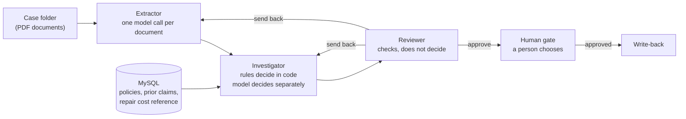

# Casefile

Multi-agent triage for auto insurance claims, with a human approval gate.

[نسخه‌ی فارسی](README.fa.md)

A claim arrives as a folder of documents: a claim form, a repair estimate and
sometimes a police report. Three agents read the documents, check them against
the policy and the claim history, and write a recommendation. A person then
approves or rejects it. **Nothing is paid or written back without that
approval**, and the database enforces this, not just the application code.

This is a practice project. Its documents are synthetic and its decision rules
are simplified. What it is meant to show is engineering discipline around a
language model: results that were measured against expectations fixed in
advance, runs that always stop, and limits that are stated plainly.

## Results

The 30 evaluation cases were run once, from PDF to human gate, with all three
agents on the model `z-ai/glm-5.3`.

| Measure | Result |
|---|---|
| Cases | 30 |
| Stopped on their own | 30 of 30 |
| Ended as pre-registered | 30 of 30 |
| Model reached the rules' outcome | 26 of 26 completed |
| Model matched outcome, reason and amount | 26 of 26 completed |
| Cases in which the reviewer sent work back | 4 |
| Write-backs without a person's approval | 0 |
| Model calls | 164 |
| Tokens, all cases | 113,844 |
| Tokens, largest case | 8,974 |
| Token ceiling per case | 200,000 |

<picture>
  <source media="(prefers-color-scheme: dark)" srcset="docs/tokens_per_case_dark.png">
  
</picture>

What the numbers say:

- **Every run stopped, and where it was expected to.** The 26 cases that
  should reach a recommendation did. The four that inject a fault the system
  cannot recover from ended as `escalated`, each through the guard the fault
  was aimed at: revision limit, invalid output, budget and step limit.
- **The model agreed with the rules in all 26 completed cases**, in outcome,
  reason and amount. None of these cases had been used to write or adjust a
  prompt.
- **The reviewer caught one mistake nobody planted.** Three of the four
  send-backs are injected faults (C25, C26, C27). The fourth, C08, is an
  ordinary claim. The decision was right, but the model's explanation said
  the payable 3,500 came from applying the 1,000 deductible to the vehicle
  amount of 3,600. It comes from the claimed total of 4,500. The reviewer
  quoted that sentence and returned the work; the rewritten explanation was
  approved.
- **Nothing was written back.** The run left 26 recommendations waiting at the
  gate, with no approval and no write-back.
- **Cost.** A typical case took three steps, five or six model calls and 3,000
  to 4,500 tokens. A call took 3.8 seconds at the median, 19 seconds at the
  90th percentile and 48 seconds at worst; the 164 calls took about 20
  minutes of model time.

Two narrower measurements stand behind this one:

| Measurement | Result |
|---|---|
| Reading the documents: fields the extractor reported exactly as the documents state them | 344 of 344, in 67 model calls |
| Deciding, on a separate development set of 30 claims: agreement with the rules at low, high and maximum reasoning effort | 28, 29 and 30 of 30 |
| Control plane with stand-in agents (no model): cases ending as pre-registered | 30 of 30 |

On the development set every disagreement was the same mistake: miscounting
how many prior claims fall inside the 36-month window. With low reasoning
effort the model answered without working it out. The evaluation uses maximum
effort for the decision, which was fixed on the development set before the
evaluation was run. The 30 of 30 with stand-in agents says only that routing,
guards and documents fit together; it is not a result of the system.

**A note on the run itself.** The live run was started in two processes at the
same time by mistake. Some requests were therefore sent to the model twice,
and for those the recordings keep one answer. The report is the replay of the
kept answers, which is also what the tests check. The summary the run printed
while live and the replayed report agree on the result of every case. Where
two answers to an identical request differed, it was in the wording of three
explanations and in token counts (113,721 in the live summary against 113,844
in the replay): a direct sign that temperature 0 and a fixed seed do not make
this service deterministic.

<details>
<summary>Result of each case</summary>

| Case | Kind | Pre-registered | Observed | Match | Model vs rules | Steps | Tokens |
|---|---|---|---|---|---|---:|---:|
| C01 | clean | recommend_pay / covered / 75920 | recommend_pay / covered / 75920 | yes | same | 3 | 3,967 |
| C02 | clean | recommend_pay / covered / 53140 | recommend_pay / covered / 53140 | yes | same | 3 | 3,832 |
| C03 | clean | recommend_pay / covered / 67540 | recommend_pay / covered / 67540 | yes | same | 3 | 3,302 |
| C04 | clean | recommend_pay / covered / 53890 | recommend_pay / covered / 53890 | yes | same | 3 | 3,660 |
| C05 | clean | recommend_pay / covered / 5080 | recommend_pay / covered / 5080 | yes | same | 3 | 3,252 |
| C06 | clean | recommend_pay / covered / 4060 | recommend_pay / covered / 4060 | yes | same | 3 | 3,770 |
| C07 | clean | recommend_pay / covered / 4670 | recommend_pay / covered / 4670 | yes | same | 3 | 4,001 |
| C08 | clean | recommend_pay / covered / 3500 | recommend_pay / covered / 3500 | yes | same | 5 | 5,962 |
| C09 | natural | refer_to_adjuster / amount_above_reference | refer_to_adjuster / amount_above_reference | yes | same | 3 | 3,566 |
| C10 | natural | refer_to_adjuster / amount_above_reference | refer_to_adjuster / amount_above_reference | yes | same | 3 | 3,131 |
| C11 | natural | refer_to_adjuster / frequent_prior_claims | refer_to_adjuster / frequent_prior_claims | yes | same | 3 | 3,969 |
| C12 | natural | refer_to_adjuster / frequent_prior_claims | refer_to_adjuster / frequent_prior_claims | yes | same | 3 | 3,650 |
| C13 | natural | refer_to_adjuster / frequent_prior_claims | refer_to_adjuster / frequent_prior_claims | yes | same | 3 | 4,426 |
| C14 | natural | recommend_deny / below_deductible | recommend_deny / below_deductible | yes | same | 3 | 3,499 |
| C15 | amount_mismatch | refer_to_adjuster / document_mismatch | refer_to_adjuster / document_mismatch | yes | same | 3 | 3,275 |
| C16 | amount_mismatch | refer_to_adjuster / document_mismatch | refer_to_adjuster / document_mismatch | yes | same | 3 | 3,806 |
| C17 | date_mismatch | refer_to_adjuster / document_mismatch | refer_to_adjuster / document_mismatch | yes | same | 3 | 4,161 |
| C18 | date_mismatch | refer_to_adjuster / document_mismatch | refer_to_adjuster / document_mismatch | yes | same | 3 | 3,899 |
| C19 | missing_document | refer_to_adjuster / missing_document | refer_to_adjuster / missing_document | yes | same | 3 | 3,377 |
| C20 | missing_document | refer_to_adjuster / missing_document | refer_to_adjuster / missing_document | yes | same | 3 | 3,514 |
| C21 | wrong_policy_number | refer_to_adjuster / policy_not_found | refer_to_adjuster / policy_not_found | yes | same | 3 | 3,076 |
| C22 | wrong_policy_number | refer_to_adjuster / policy_not_found | refer_to_adjuster / policy_not_found | yes | same | 3 | 3,146 |
| C23 | incident_outside_coverage | recommend_deny / incident_outside_policy_period | recommend_deny / incident_outside_policy_period | yes | same | 3 | 3,367 |
| C24 | incident_outside_coverage | recommend_deny / incident_outside_policy_period | recommend_deny / incident_outside_policy_period | yes | same | 3 | 3,209 |
| C25 | extractor_error_first_attempt | recommend_pay / covered / 71930 | recommend_pay / covered / 71930 | yes | same | 6 | 6,353 |
| C26 | extractor_error_first_attempt | recommend_pay / covered / 59000 | recommend_pay / covered / 59000 | yes | same | 6 | 6,580 |
| C27 | reviewer_never_approves | escalated / max_revisions | escalated / max_revisions | yes | no decision (run stopped) | 9 | 8,974 |
| C28 | repeated_schema_errors | escalated / schema_errors | escalated / schema_errors | yes | no decision (run stopped) | 3 | 703 |
| C29 | budget_too_small | escalated / budget_exceeded | escalated / budget_exceeded | yes | no decision (run stopped) | 0 | 0 |
| C30 | step_limit_too_small | escalated / max_steps | escalated / max_steps | yes | no decision (run stopped) | 2 | 2,417 |

</details>

Read these results together with [what they do not show](#what-these-results-do-not-show).

## How it works



A **supervisor** moves the case from agent to agent. It is ordinary code, not
a model, and it is the only thing that decides who runs next and when to stop.

| Agent | What it does | Where the model is used |
|---|---|---|
| Extractor | Reads each PDF and returns typed fields | One request per document, constrained to a JSON schema |
| Investigator | Looks up the policy, the claim history and the usual repair cost; produces two decisions | The model decides on its own, then explains both decisions |
| Reviewer | Checks that amounts add up and that the rules' decision follows from the facts; checks the explanations | Only to check that the explanations state nothing the facts do not support |

Four outcomes are possible, and all of them end in front of a person:

| Outcome | Meaning |
|---|---|
| `recommend_pay` | Pay the claimed total minus the deductible |
| `recommend_deny` | Do not pay, with the reason |
| `refer_to_adjuster` | Something needs a person's judgement |
| `escalated` | The system stopped itself: a limit was reached |

### Two decisions, not one

For every claim the investigator produces two decisions:

- the **rules' decision**, computed in code by eight rules applied in a fixed
  order;
- the **model's decision**, reached from the same facts and the same rules in
  words, in a request that does not show what the code decided.

Neither overrules the other. Both go to the person at the gate, each with an
explanation, and an approval must say which of the two is carried out. How
often the two agree is the measure of how far the model can be trusted with
this task.

## Design decisions and what they cost

**The supervisor is deterministic.** Routing and stopping are a state machine
in code. A run can therefore be replayed exactly, and its termination is
proved by tests rather than hoped for. The cost is flexibility: the route
through the agents is fixed, and a new kind of step means new code.

**Four stopping guards.** A run ends when it has taken 12 steps, when the
reviewer has sent work back to the same agent more than 3 times, when the next
model call could exceed the token ceiling, or when an agent returns invalid
output twice in a row. The budget guard looks at the worst case of a call
*before* making it, not at the bill afterwards. Property-based tests let
agents behave arbitrarily, forever, and check that the run still stops inside
every limit; breaking any one guard on purpose makes those tests fail.

**Typed handoffs.** Agents exchange Pydantic models, never free text. An
answer that does not fit its schema is not repaired or guessed at; it counts
as invalid output and goes to the guard above.

**Contradictions are found in code.** The extractor only reports what each
document says. Whether the repair estimate disagrees with the claim form is a
comparison of two extracted numbers, done in code. Each document is also read
in a request of its own: shown all documents at once, a model tends to
reconcile them and the contradiction disappears in the reading.

**The reviewer does not arbitrate.** A disagreement between the rules and the
model is information for the person at the gate, not a fault to be sent back.
The reviewer checks arithmetic and the rules' decision in code, and asks the
model one narrow question: do the explanations state anything the facts do not
support?

**Cost is counted in tokens.** The model is used through a free trial
service, so there is no price to apply. The worst case of a request is bounded
without a tokenizer, from the fact that a token covers at least one byte. The
bound is three to four times the real figure for English text; that looseness
is the price of not depending on one model's tokenizer.

**The human gate lives in the database.** A write-back row must reference an
approval for the same claim whose decision is "approved"; a composite foreign
key makes any other row impossible to insert, whatever the application does.
Unique keys allow one decision per recommendation and one write-back per
claim.

**Five database accounts, each with the least it needs.** The agents' account
can read policies, prior claims and the repair cost reference, and nothing
else. In particular it cannot read the current claims, which hold the very
values the agents must take from the documents. The system's own account can
store recommendations and write-backs but cannot insert an approval, so the
automated side has no credentials with which to approve itself. All five
passwords sit in one `.env` file on one machine here; in a real deployment the
approver's account would belong to a separate service.

**Every model answer is recorded.** A model does not answer the same way
twice, so a run cannot be repeated by calling it again. With the recordings in
`recordings/`, every reported number can be reproduced without the model, an
API key or a network connection.

**Checkpoints are written synchronously.** Runs go through LangGraph with a
MySQL checkpointer, and LangGraph only persists state; the supervisor still
decides everything. With LangGraph's default setting a checkpoint is written
in the background while the next step runs. A test that kills the process
outright showed that the step before the kill could be lost. Checkpoints are
now written before the next step starts. A gentler test, raising an exception
inside the same process, had not revealed this.

**Expectations were fixed before the agents existed.** The 30 evaluation
cases and the result each must reach were committed in the repository's first
commit, when no agent had been written. The expected results are computed by
the rules, and the cases are drawn with a fixed seed, so neither the cases nor
the answers were chosen by hand.

**Prompts were tuned on other cases.** Trying prompts on the evaluation cases
would fit the system to the cases it is judged on. A separate development set
of 30 claims, none of them in the evaluation, was drawn for that purpose. The
evaluation cases were then run once.

## Evaluation

### The cases

`eval/cases.yaml` holds 30 cases in four groups:

| Group | Cases | What is tested |
|---|---:|---|
| Clean | 8 | Ordinary claims, two of each incident type; expected to be paid |
| Natural | 6 | Claims that trip a rule on their own: amount above the usual range, frequent prior claims, claim below the deductible |
| Document defect | 10 | A defect planted in the documents: amount mismatch, date mismatch, missing document, unknown policy number, incident before the policy started |
| System stress | 6 | A fault injected into the running system: an extractor that misreads once, a reviewer that never approves, an agent that keeps returning invalid output, a budget that is too small, a step limit that is too small |

The planted defects and their true values are listed in `eval/defects.json`.
That file and `eval/cases.yaml` are the answer key; the agents are given the
case folders only.

### The rules

Applied in this order; the first that holds decides.

| # | Reason | Condition | Outcome |
|---:|---|---|---|
| 1 | `policy_not_found` | No policy has the number on the claim form | refer |
| 2 | `incident_outside_policy_period` | The incident is dated before the policy started | deny |
| 3 | `missing_document` | There is no repair estimate | refer |
| 4 | `document_mismatch` | The repair estimate differs from the claimed vehicle amount, or the police report gives another incident date | refer |
| 5 | `amount_above_reference` | The claimed vehicle amount is above the usual range for this kind of incident | refer |
| 6 | `frequent_prior_claims` | Three or more prior claims in the 36 months before the incident | refer |
| 7 | `below_deductible` | The claimed total does not exceed the deductible | deny |
| 8 | `covered` | None of the above | pay the total minus the deductible |

These rules are hypothetical. They are not taken from any insurer's
guidelines; they exist so that an expected result can be computed.

### What was measured, and on what

| Measurement | Cases | Agents | Report |
|---|---|---|---|
| Control plane alone | the 30 evaluation cases | stand-ins without a model | `reports/mock_run_report.json` |
| Reading documents | the documents of the 30 evaluation cases | real extractor | `reports/extraction_report.json` |
| Deciding and reviewing | 30 development cases | real investigator and reviewer, flawless extraction assumed | `reports/dev_decisions_report.json` |
| The whole system | the 30 evaluation cases | all three real agents | `reports/live_run_report.json` |

## What these results do not show

- **The documents are easy.** They are clean, text-based PDFs generated from
  templates. Scans, handwriting, photos and incomplete forms are much harder
  and are not tested; no OCR is involved.
- **The numbers are small.** Thirty cases support statements like "all 30
  stopped"; they do not support a percentage with a confidence interval.
- **Each figure is one run.** Requests use temperature 0 and a fixed seed, but
  the service does not promise identical answers. The recordings make the
  reported run reproducible; they do not show how much another run would
  differ.
- **The rules are invented and simple.** Real triage weighs far more than
  eight conditions.
- **The claim history is synthetic.** Neither dataset contains earlier claims
  per policy. Only the *number* of earlier claims follows real data; their
  dates are random and their content is copied from other policies' claims,
  at 2015 amounts with no adjustment for inflation.
- **The repair cost reference is circular.** It is derived from the same
  claims it is later compared with, so about nine in ten fall inside it by
  construction. Its severity bands barely differ, because severity hardly
  predicts amount in this dataset.
- **The source data is of unclear origin.** `insurance_claims.csv` contains
  fields that contradict each other (see below). Its fraud label is not used
  anywhere in this project.
- **Some generated documents are implausible.** Repair line items are split
  at random, so a tail lamp can cost ten thousand dollars; one back-dated case
  puts a 2006 vehicle in a 1996 incident. The expected results do not depend
  on these details.
- **One model, one provider.** Everything was measured with `z-ai/glm-5.3`
  through a trial service. The client works with any OpenAI-compatible API,
  but no other model was tried.
- **No tracing backend.** A run's exact path, tokens and model answers are
  stored and can be replayed, but they are not exported to a tracing system.

## Data

Two public datasets are used. Neither is in this repository; download them
into `data/raw/`.

| File | Source | Used for |
|---|---|---|
| `insurance_claims.csv` | [mwitiderrick/insurancedata](https://github.com/mwitiderrick/insurancedata) | 1,000 policies with one claim each |
| `fraud_oracle.csv` | [Vehicle Claim Fraud Detection (Kaggle)](https://www.kaggle.com/datasets/shivamb/vehicle-claim-fraud-detection) | The distribution of the number of earlier claims; nothing else |

The loaders check each file's SHA-256 against the versions they were built
with and refuse an unknown file, so a different edition of a dataset cannot
silently produce different tables.

What is real and what was made:

| Table | Rows | Origin |
|---|---:|---|
| `policies` | 999 | From `insurance_claims.csv` |
| `claims` | 999 | From `insurance_claims.csv` |
| `prior_claims` | 1,925 | Synthetic, fixed seed |
| `repair_cost_reference` | 10 | Derived: 5th percentile, median and 95th percentile of the vehicle amount per incident type and severity |

Findings from profiling `insurance_claims.csv`, and what was done about them:

- `policy_bind_date` contradicts `months_as_customer`: in 199 rows the
  policyholder would have been under 16 when the policy was bound. The policy
  start date is derived from the tenure instead.
- `bodily_injuries = 0` in 340 rows, yet 330 of them claim an injury amount;
  `property_damage = NO` in 338 rows, yet 332 claim a property amount. The
  amounts are treated as the truth, and the two flags are computed from them.
- One row has a negative umbrella limit. It is not loaded, and the reason is
  recorded in `reports/domain_load_report.json`. Guessing the intended value
  would be inventing data.
- The literal string `None` is a real category in `authorities_contacted`.
  The file is read as plain text so that it is not turned into a missing
  value.
- Occupation, education, hobbies, relationship and capital gains are not
  loaded: they have no bearing on triage and must not influence it.

## Running it

Requirements: Python 3.11 or later (developed on 3.13) and MySQL 8.0.19 or
later (developed on 8.0.46).

```bash
python -m venv .venv
.venv/Scripts/python -m pip install -e ".[dev]"      # Windows
# .venv/bin/python -m pip install -e ".[dev]"        # Linux, macOS
```

The commands below are written as `python`; use the interpreter of the
virtual environment.

**1. Reproduce the reported results, with no database and no model.** Put the
two CSV files in `data/raw/`, then:

```bash
python -m casefile.eval.run_live --mode replay        # the full evaluation, step by step
python -m casefile.eval.run_extraction --mode replay  # reading the documents
python -m casefile.eval.run_dev --mode replay         # the development set
python -m casefile.eval.run_mock                      # the control plane with stand-ins
python -m casefile.eval.summary                       # the result tables of this README
python -m casefile.eval.charts                        # the chart
```

**2. Set up the database.** This creates two databases and five accounts,
generates their passwords into `.env`, applies the schema and proves that
each limited account is refused what it must not do.

```bash
python scripts/setup_database.py --ask-admin-password
python -m casefile.data.load_domain
python -m casefile.data.prior_claims
python -m casefile.data.repair_cost_reference
python -m pytest
```

**3. Run with a model of your own.** Set the three `CASEFILE_LLM_*` values in
`.env` (see `.env.example`); any OpenAI-compatible chat completions API that
supports JSON-schema output will do.

```bash
python -m casefile.llm.check                          # is the model reachable?
python -m casefile.eval.run_live --suite dev --cases C01
```

A live run of the evaluation suite continues from its MySQL checkpoints, so
it does not start again on a machine where it has already run.

**4. Work the human gate.**

```bash
python -m casefile.gate pending
python -m casefile.gate approve 12 --choose rule --approver "J. Smith"
python -m casefile.gate reject 13 --approver "J. Smith" --comment "..."
python -m casefile.gate write-back 7
```

## Repository layout

```
db/schema/            MySQL schema: domain tables, claim history, reference, human gate
scripts/              setup_database.py: databases, accounts, privileges
src/casefile/
  data/               loading and generating the domain data
  documents/          the synthetic PDF documents and their planted defects
  rules.py            the eight triage rules
  control/            supervisor, case state, typed handoffs, LangGraph wiring, checkpoints
  agents/             extractor, investigator, reviewer; stand-ins; database lookups
  llm/                model client, token metering, record and replay
  gate.py             the human gate
  eval/               case selection, fault injection, runners, reports
eval/                 cases.yaml and defects.json: the pre-registered answer key
data/cases/           the documents the agents read, one folder per case
recordings/           every model answer behind the reported numbers
reports/              the reports the numbers in this README come from
tests/                unit, property-based and database tests
```

## Tests

`python -m pytest` runs the unit tests, the property-based tests of the
supervisor, the database constraint and privilege tests, the kill-and-resume
test of the checkpoints, and the offline replays that must reproduce each
report exactly. Tests that need MySQL or the raw datasets are skipped when
those are not available.

## Acknowledgements

The project follows brief 02 of *Six projects that prove you can do the job*
(BASWE).

## License

[MIT](LICENSE). The datasets are not part of this repository and remain under
their own terms.
